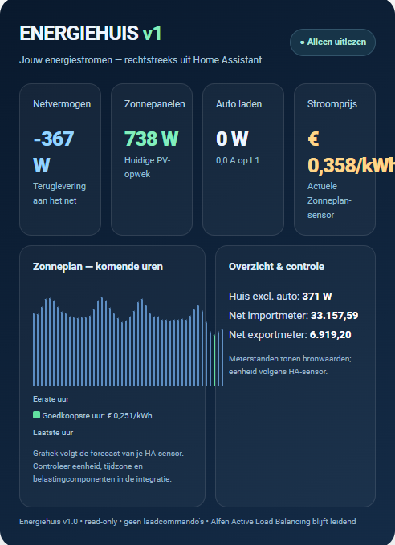

# Energiehuis — Home Assistant dashboardkaart

## In ontwikkeling: Energiehuis v1.12.0 – drie afzonderlijke batterijen (RC)

Nieuwe capaciteitsvergelijking [concept-PR #17](https://github.com/eelbrethouwer-jpg/energiehuis_card/pull/17): afzonderlijke 5/10/15-kWh SOC, optioneel per capaciteit instelbare laad-/ontlaadvermogens, bruikbare opslag en theoretische niet opgeslagen zonne-energie door volle batterij of laadlimiet. **Geen Home Assistant-YAML nodig**, geen laadbesturing. Zie [release notes](RELEASE_NOTES_v1.12.0_RC.md) en [testinstructies](BATTERY_PROFILES_V112.md). Niet gepubliceerd in HACS.

## v1.11.0 – Batterij Simulator 3.0 (versiecorrectie in voorbereiding)

Op basis van de gepubliceerde **v1.10.0** met behoud van de verbeterde Alfen-laadgeschiedenis en de standaard **uitgeschakelde** optionele scriptbediening. De nieuwe batterijpagina leest maximaal zeven volledige dagen P1-uurgegevens en toont een interactieve SOC-uurcurve, capaciteit 5/10/15 kWh, zonneladen en (alleen bij complete historische prijzen) theoretisch goedkoop netladen. Historische euroresultaten blijven **scenario's**, geen gerealiseerde besparingen.

Lees [v1.11.0 release notes](RELEASE_NOTES_v1.11.0_RC.md) en [Home Assistant-datacontrole](BATTERY_SIMULATOR_3_DATA.md). Geen extra YAML nodig als bestaande P1-uurstatistieken beschikbaar zijn. De functies zijn via [PR #15](https://github.com/eelbrethouwer-jpg/energiehuis_card/pull/15) samengevoegd; de officiële tag `v1.11.0` is nog niet gepubliceerd. De bestaande `v1.10.1`-release heeft onjuist een v1.11.0-beschrijving.

## In ontwikkeling: v1.10.0-rc.1 – Alfen-laadsessies en optionele scriptbediening

Meer nauwkeurige Alfen-laadgeschiedenis en voorbereid, **standaard uitgeschakeld** bedieningspaneel. Eerste acceptatie: verbeterde meetdiagnose en veilige standaardstand zonder fysieke aansturing. Vóór activeren is een aparte Home Assistant-script-/Active-Load-Balancing-controle verplicht. Zie [v1.10.0 RC release notes](RELEASE_NOTES_v1.10.0_RC.md). Deze uitbreiding behoudt de bestaande v1.9.1-batterijvergelijking.

## In voorbereiding: v1.9.1 — Batterijcapaciteit vergelijken

Releasekandidaat: duidelijke 5/10/15-kWh-capaciteitsvergelijking, uitleg bij identieke scenario-uitkomsten, weergave van onvolledige meetdagen en expliciete scheiding van de **vaste 10-kWh-simulatie** bovenaan. Zie [v1.9.1 release notes](RELEASE_NOTES_v1.9.1_RC.md). Nog niet gepubliceerd.

## In ontwikkeling: v1.9.0-rc.1 – Mobiele App Experience

Er is een aparte releasekandidaat met een mobiele werkbalk, compacte/ruime weergave, veilige offline-indicatie en een zichtbaarheidsgestuurde vaste onderste navigatie. **Nog geen zelfstandige installeerbare PWA**; de HACS-kaart blijft de ondersteunde basis. Bekijk [RC release notes](RELEASE_NOTES_v1.9.0_RC1.md) en [PWA-verkenning](PWA_SPIKE_v1.9.0.md).

Voor dashboards met meerdere Lovelace-kaarten kun je eventueel `mobile_fixed_navigation: false` gebruiken in de kaartconfiguratie. De standaardmodus blijft compact op mobiele schermen en de keuze wordt alleen als lokale UI-voorkeur bewaard.

## Hotfix v1.8.2 – selectie virtuele batterij

De virtuele-batterijcapaciteit (5, 10 of 15 kWh) is weer aanklikbaar. De keuze past uitsluitend de simulatie aan. Zie [release notes v1.8.2](RELEASE_NOTES_v1.8.2.md).

## Herstelrelease v1.8.1 – correcte Energy Insights & Cost Control-code

**Let op:** de op 22 oktober 2026 gepubliceerde `v1.8.0`-tag verwijst abusievelijk naar dezelfde commit als `v1.7.1`. Daardoor bevatte de HACS-installatie geen nieuwe v1.8.0-functionaliteit. De correcte implementatie is voorbereid als **v1.8.1**. Zie [de v1.8.1 release notes](RELEASE_NOTES_v1.8.1.md). Installeer pas na publicatie de nieuwe tag in HACS; controleer in het dashboard de daadwerkelijke functies.

**Na v1.8.1:** [Energiehuis v1.9.0 – Standalone PWA Edition](ROADMAP_v1.9.0_PWA.md), met een zelfstandiger app-gevoel op iPhone en Android.



Energiehuis is een eigen, mobielvriendelijke Home Assistant-interface voor energie-inzicht. De kaart combineert P1, GoodWe, Alfen, Cupra, Zonneplan, de virtuele thuisbatterij en optioneel gas/water in één HomeWizard-achtige omgeving.

> Energiehuis blijft standaard **alleen-lezen**. In v1.10.0 is de apart configureerbare Home Assistant-scriptbediening standaard uitgeschakeld en mag deze uitsluitend na een geverifieerde backendveiligheidscontrole worden ingeschakeld. De simulatorknoppen verzenden nooit laadopdrachten. Alfen Active Load Balancing en de 1×40A-netaansluiting blijven leidend. Zie [veiligheidsvereisten](RELEASE_NOTES_v1.10.0_RC.md).

## Nieuw in v1.7.1 — Gas & Water hotfix

- Gas vandaag gebruikt nu standaard de bestaande sensor `sensor.gas_vandaag_2`; cumulatieve gasmeter `sensor.gas_meter_gas` blijft apart.
- Watermeter en live waterdebiet worden automatisch herkend indien er precies één goed onderbouwde sensor wordt gevonden. Handmatig gekoppelde entiteiten behouden voorrang.
- Ontbreekt een watersensor voor het dagverbruik, dan probeert Energiehuis het dagtotaal uit Home Assistant Recorder te berekenen op basis van een beginstand vóór middernacht. De daghoeveelheid wordt in liters weergegeven; meterstanden in m³.
- Overzicht, gas-/waterdetail en Meer tonen nu consistente bronvermeldingen.
- De bestaande nulmeting kan ook de herkende cumulatieve watermeter gebruiken zonder originele meterstanden te wijzigen.

**Opmerking:** de waterentiteitsnamen zijn nog niet uit jouw Home Assistant-installatie bevestigd. Als automatische herkenning geen eenduidige sensor vindt, vul `water`, `water_today` en/of `water_flow` met de werkelijke entiteitsnamen in. Zie [release notes v1.7.1](RELEASE_NOTES_v1.7.1.md).

## Nieuw in v1.7.0 — Smart Energy Intelligence

- **Energiecoach:** advies over goedkope volledige stroomuren en actuele zonneopwek.
- **Slim laden 2.0:** direct versus goedkoop laden versus zonneladen, met volledige uren, 1×40 A-limiet, huisverbruik, laadvermogen en rekenrendement. Zonneladen vereist een expliciete PV-uurprognose; de kaart stuurt niet.
- **Financiële maandprognose:** stroomkosten en optionele gas-maandkosten met instelbaar budget van €200 en duidelijk onderscheid tussen volledige en gedeeltelijke totalen.
- **Cupra laadgeschiedenis:** herkenning uit de laatste 14 dagen Alfen-energiehistorie en Zonneplan-tariefhistorie, inclusief aanduiding bij ontbrekende prijsmetingen.
- **Virtuele batterij 2.0:** indicatieve capaciteitsvergelijking 5/10/15 kWh uit zeven volledige historische dagen import/export.
- **Systeemcontrole:** actualiteit en gezondheid van de zes belangrijkste databronnen.
- **Meterbeheer & Reset:** onder **Meer → Geavanceerd**, individuele P1-/Alfen-/gas-/watermeters selecteren en een nulmeting instellen na een tweede bevestiging. Geen fysieke tellerreset.

### Eenmalige installatie voor Meterbeheer

Installeer het optionele [nulmeting-package](packages/energiehuis_v17_reset.yaml) in Home Assistant op `/config/packages/energiehuis_v17_reset.yaml` (mits packages in `configuration.yaml` zijn geactiveerd). Controleer de configuratie en herstart. De benodigde helper is `input_text.energiehuis_reset_baselines`. De helper bewaart baselines over Home Assistant-herstarts; HACS installeert het YAML-package niet automatisch. **Alternatief zonder YAML:** ga in Home Assistant naar Instellingen → Apparaten & diensten → Helpers → Helper toevoegen → Tekst. Kies maximale lengte 255 en stel het entiteits-ID in op `input_text.energiehuis_reset_baselines` (of pas `reset_store` in de kaartconfiguratie aan). Maak dezelfde helper niet óók via het package aan.

Kies in de verborgen meterbeheeromgeving de gewenste meters en klik op **Nieuwe nulmeting voor selectie**. Bevestig in de aparte waarschuwingsdialoog. De historische sensoren en fysieke meters blijven onaangetast. De verschilwaarden worden op dit moment zichtbaar in Meterbeheer, en de nieuwe beginstand is ook beschikbaar in de aanvullende contractperiode-uitlezing. Oude maand- en jaarkosten worden niet overschreven.

Optionele instellingen om aan de bestaande kaartconfiguratie toe te voegen:

```yaml
reset_store: input_text.energiehuis_reset_baselines
gas_cost_month: ""
monthly_budget_eur: 200
pv_forecast: ""
pv_total_energy: ""
billing_total_cost: ""
export_compensation_eur_kwh: null
battery_buy_eur_kwh: 0.25
battery_sell_eur_kwh: 0.08
battery_roundtrip_efficiency: 0.88
fuse_amp: 40
charger_amp: 32
reserve_amp: 2
ev_charge_efficiency: 0.90
```

De waarden voor batterijtarieven, laadverliezen en huislasten zijn expliciete rekenaannames. De financiële simulaties zijn geen rekening of werkelijk geboekte besparing. Zie [Release notes v1.7.0](RELEASE_NOTES_v1.7.0.md) voor technische beperkingen en verificatie.

## Nieuw in v1.6.1 — Cupra & Slim laden

De onderste navigatie heeft nu **zes tabbladen**: Overzicht, Cupra, **Cupra & Slim laden**, Batterij, Kosten en Meer.

- **Cupra:** voertuigstatus en alle historische **Cupra Insights** (kilometers, temperatuur, actieradius en verbruik).
- **Cupra & Slim laden:** opent direct de praktische laadomgeving, zonder eerst door Cupra Insights te scrollen.
- De nieuwe laadpagina begint met **actuele Alfen-laadstatus**, gevolgd door **laadscenario**, **planningsmodus** en **Zonneplan-prijsgrafiek / verwachte laadplanning**.
- Op smalle telefoons heet de nieuwe navigatieknop kort **Slim laden**, met de volledige toegankelijke naam **Cupra & Slim laden**.
- Behoud van simulatiewaarden (SOC-doel, vertrek, kWh, kW, laadmodus) bij wisselen van tabbladen zolang de kaart open staat.
- **Geen wijzigingen** aan gebruikte entiteiten, prijsberekeningen of actieve laadsturing; de kaart blijft alleen uitlezen.

## Nieuw in v1.6.0

- Nieuwe **Cupra Insights**-sectie op de Cupra-pagina.
- Kilometers: vandaag, deze week, deze maand en dit jaar.
- Kilometerhistorie per dag; bij jaarweergave per maand.
- Praktijkactieradius uit werkelijk gereden kilometers en SOC-verlies.
- Geschat verbruik in kWh/100 km op basis van 59 kWh bruikbare accucapaciteit.
- Temperatuuranalyse in zes temperatuurklassen.
- Vergelijking tussen genormaliseerde Cupra-range en gerealiseerde praktijkrange.
- Verwachte praktijkrange bij de huidige buitentemperatuur zodra voldoende eigen historie beschikbaar is.
- Cabine-doeltemperatuur als extra analysefactor.
- Samenhang tussen buitentemperatuur / setpointverschil en geschat verbruik.
- Alfen wordt gebruikt om thuislaadmomenten uit rijsegmenten te filteren.
- Een SOC-stijging zonder overeenkomstige Alfen-laadenergie wordt gemarkeerd als vermoedelijk extern laden.
- Empirische thuislaadefficiëntie uit gekoppelde Cupra-SOC- en Alfen-energie-intervallen, verankerd op SOC-updates zodat stilstaand laden niet afhankelijk is van kilometerupdates.
- Datakwaliteitslabel **Beperkt / Opbouwend / Sterk**.
- De analyse gaat uit van de bewust gekozen Cupra/VW Group Connect-verversing van circa **15 minuten**.

### Cupra Insights databronnen

Standaard gebruikt Energiehuis:

```yaml
cupra: sensor.garage_cupra_born_accuniveau
cupra_mileage: sensor.garage_cupra_born_kilometerstand
cupra_range: sensor.garage_cupra_born_actieradius
cupra_outside_temp: sensor.garage_cupra_born_buitentemperatuur
cupra_target_temp: sensor.garage_cupra_born_doeltemperatuur
cupra_charged_energy: sensor.garage_cupra_born_geladen_energie
cupra_charge_target: sensor.garage_cupra_born_laaddoel
cupra_climate_usage: sensor.garage_cupra_born_klimaatverbruik
cupra_onboard_usage: sensor.garage_cupra_born_verbruik_boordnet
laad_energie: sensor.alfen_geleverde_actieve_energie_totaal
cupra_usable_kwh: 59
cupra_refresh_minutes: 15
```

Voor kilometerstanden gebruikt Energiehuis waar mogelijk Home Assistant-langetermijnstatistieken. De fijnmazige efficiëntie- en temperatuurcorrelatie gebruikt de detailhistorie die Recorder daadwerkelijk beschikbaar heeft. De getoonde dekkingsperiode maakt daarom zichtbaar hoeveel historie voor die analyse is gebruikt.

## Nieuw in v1.4.0

- Gas en water toegevoegd aan het algemene overzicht.
- Cupra SOC gebruikt standaard de echte EU Data Act-sensor als die aanwezig is.
- Virtuele batterij standaard gekoppeld aan de bestaande batterij-SOC.
- Onderste navigatie is nu volledig intern:
  - Overzicht
  - Cupra
  - Batterij
  - Kosten
  - Meer
- Nieuwe pagina **Batterij**:
  - kosten zonder batterij
  - kosten met batterij
  - totale netto besparing
  - besparing vandaag / maand / jaar
  - vermeden inkoop
  - kosten van netladen
  - gemiste terugleveropbrengst
- Nieuwe pagina **Kosten**:
  - actuele Zonneplan-prijs
  - Zonneplan dag/maand/jaar
  - Vattenfall 1- en 3-jaarsreferenties
  - voordeel versus Vattenfall
  - besparing door slimme timing
- Nieuwe pagina **Meer** met gas- en waterstatus.
- Water-entiteiten worden bewust niet geraden: ze kunnen expliciet in de kaartconfiguratie worden gekoppeld.

## Bestaande functies

- Live overzicht van:
  - netvermogen
  - zonnepanelen
  - woningverbruik
  - stroomprijs
  - Cupra Born
  - virtuele batterij
- Interactieve vermogensgrafiek.
- Klikbare detailgrafieken voor net, zon, huis en Cupra.
- Periodes:
  - Vandaag
  - Gisteren
  - 7 dagen
  - 30 dagen
  - Dit jaar
  - Vorig jaar
- Cupra laadplanner op basis van Zonneplan-prijzen.
- Prijsinspectie per tijdstip.
- Mobiel geoptimaliseerde vaste navigatie.

## Installatie via HACS

1. Voeg deze repository in HACS toe als aangepaste repository, type **Dashboard**.
2. Download Energiehuis.
3. Gebruik de HACS-resource:

`/hacsfiles/energiehuis-card/energiehuis-card.js`

4. Voeg de kaart toe aan een dashboard:

```yaml
type: custom:energiehuis-card
net: sensor.p1_meter_vermogen
zonnepanelen: sensor.goodwe_pv_power
laden: sensor.alfen_actief_vermogen_totaal
stroom: sensor.alfen_stroom_l1
prijs: sensor.zonneplan_current_hourly_electricity_tariff
huis: sensor.energiehuis_huisverbruik_exclusief_auto
import: sensor.p1_meter_energie_import
export: sensor.p1_meter_energie_export
cupra: sensor.garage_cupra_born_accuniveau
batterij: sensor.virtuele_batterij_soc
gas: sensor.gas_meter_gas

# Optioneel: vul de echte HomeWizard-waterentiteiten in zodra bekend.
water: ""
water_today: ""
water_flow: ""

# Optioneel: als je al een aparte gas-dagteller hebt.
gas_today: ""
```

## Optionele financiële sensoren

v1.4.0 kan onderstaande bestaande Energiehuis-sensoren gebruiken. Als een sensor niet bestaat, wordt geen fictieve waarde getoond.

```yaml
battery_soc_kwh: input_number.virtuele_batterij_soc_kwh
battery_status: sensor.virtuele_batterij_status
battery_saving_day: sensor.virtuele_batterij_besparing_dag
battery_saving_month: sensor.virtuele_batterij_besparing_maand
battery_saving_year: sensor.virtuele_batterij_besparing_jaar
battery_cost_without_month: sensor.virtuele_batterij_kosten_zonder_maand
battery_cost_with_month: sensor.virtuele_batterij_kosten_met_maand
battery_avoided_import_month: sensor.virtuele_batterij_vermeden_inkoop_maand
battery_grid_charge_cost_month: sensor.virtuele_batterij_kosten_netladen_maand
battery_lost_export_month: sensor.virtuele_batterij_gemiste_teruglevering_maand

cost_zonneplan_day: sensor.kosten_zonneplan_stroom_dag
cost_zonneplan_month: sensor.kosten_zonneplan_stroom_maand
cost_zonneplan_year: sensor.kosten_zonneplan_stroom_jaar
cost_vattenfall_1_month: sensor.kosten_vattenfall_1_jaar_stroom_maand
cost_vattenfall_3_month: sensor.kosten_vattenfall_3_jaar_stroom_maand
saving_smart_month: sensor.besparing_slim_stroomgebruik_maand
advantage_vattenfall_1_month: sensor.voordeel_zonneplan_vs_vattenfall_1_jaar_maand
advantage_vattenfall_3_month: sensor.voordeel_zonneplan_vs_vattenfall_3_jaar_maand
```

## Financiële scheiding

De batterij-businesscase en het contractvoordeel worden bewust gescheiden.

**Batterijbesparing** vergelijkt de kosten zonder batterij met de kosten mét virtuele batterij. Kosten van netladen, gemiste teruglevering en vermeden dure inkoop horen daarbij.

**Zonneplan/Vattenfall** en **slimme timing** zijn afzonderlijke voordelen. Energiehuis telt deze bedragen niet automatisch bij de batterijbesparing op, om dubbeltelling te voorkomen.

## Veiligheid

- Geen tokens in de frontend.
- Geen externe requests.
- Geen Alfen-laadcommando's vanuit de kaart.
- De bestaande Active Load Balancing blijft leidend.
- Backend-YAML onder `/config/packages/` wordt niet door HACS bijgewerkt.

## Ontwikkelrichting

Na Energiehuis v1.7.0 volgen verdere modularisering, instellingen vanuit Energiehuis zelf, uitgebreidere water/gas-grafieken en verdere verfijning van de persoonlijke energie- en mobiliteitsanalyse.


## Stroomvergelijker (v1.13.0 releasekandidaat)

Open **Kosten → Stroomvergelijker**. Voeg een contract toe en vul alle tarieven in (expliciet 0 als kosten niet gelden). Met **Zonneplan instellen** kies je de historische afnameprijssensor; tarieven worden niet vooraf ingevuld. De huidige Vattenfall-grafieken blijven op de bestaande kostenpagina.

De nieuwe vergelijking gebruikt dezelfde afgeronde P1-meeturen voor alle contracten. Kies maand, jaar of eigen periode en klik een kostenbalk open voor details. Onvolledige P1-/prijshistorie levert geen schijnbaar compleet totaal op. Gebruik **Export / import** voor een back-up of overdracht naar een ander apparaat. Contracten blijven lokaal in deze browser; er worden geen HA-helpers aangemaakt.

De uitkomst betreft **indicatieve leverancierskosten**. Uurmiddelden zijn geen exacte kwartierafrekening; teruglevering gebruikt een vast ingevoerd tarief. Geen automatisch bijgewerkte aanbiedingen, staffels, welkomstkortingen, netbeheer, belastingvermindering of dynamische terugleverprijzen. Saldo over de geselecteerde periode is slechts een expliciet gekozen scenario, geen vastgestelde jaarafrekening. Zie de [volledige grenzen en teststatus](RELEASE_NOTES_v1.13.0_RC.md).


### Aanbieders uit tarievenlijst (v1.13.0-rc.2)

Via **Aanbieder uit tarievenlijst** haal je openbare aanbiedingen op van [energieprijzen-nl](https://github.com/zhinees/energieprijzen-nl) (CC BY 4.0). Kies vast/dynamisch, open een concept en controleer bronbedragen, controledatums, opmerkingen en periode. Bevestiging is verplicht vóór opslaan; ontbrekende kosten en energiebelasting vul je zelf in. Opgeslagen contracten worden bij vernieuwen niet overschreven.

Voor dynamische lijstcontracten heb je een HA-prijssensor nodig met **kale beursprijs inclusief btw, zonder energiebelasting of leveranciersopslag**. Deze release maakt die sensor niet aan. Koppel geen volledige Zonneplan-prijs als kale beursprijs. Teruglevering kan dezelfde marktprijs plus een getekende correctie gebruiken. Oude handmatige contracten blijven werken.

Maandkosten worden naar rato van kalenderdagen verdeeld. De uitkomst blijft indicatief: geen automatische staffels, actieprijzen, salderingsregels of historische tariefwijzigingen. Zie [RC2-notes](RELEASE_NOTES_v1.13.0_RC2.md) en [bronvermelding](THIRD_PARTY_TARIFF_DATA.md).
