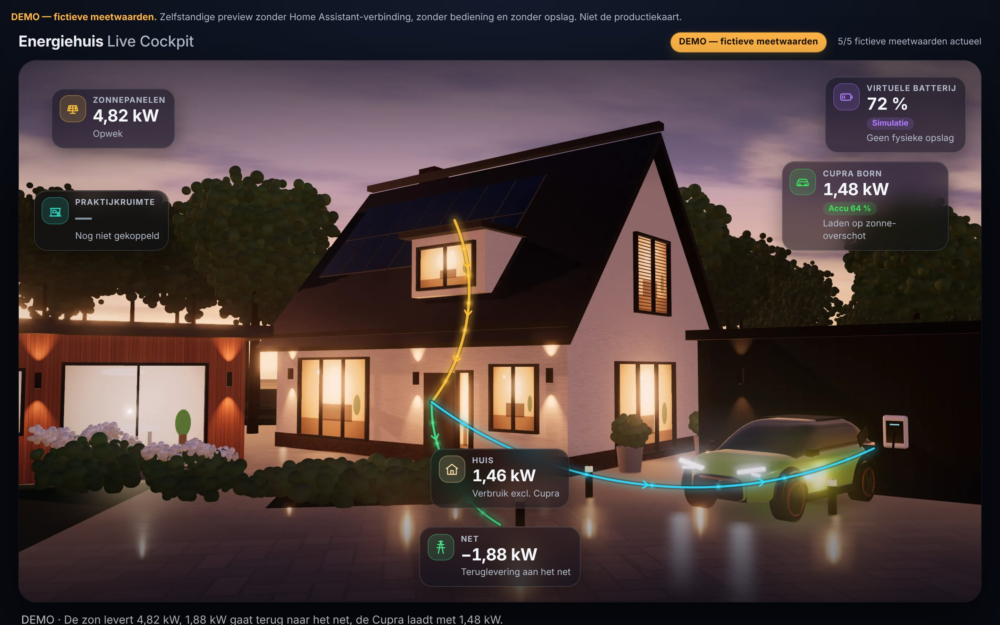

# PVE-03 — Cinematic Energy Experience (DEMO)

> **DEMO — fictieve meetwaarden.** Zelfstandige browserpreview. Geen Home Assistant-verbinding, geen bediening, geen opslag, geen productiekaart, geen HACS-resource.

Fase 1 van de Premium Live Cockpit, gebouwd door Claude Code op branch `preview/claude-premium-pve03`.
Opdracht: [CLAUDE_CODE_OPDRACHT.md](CLAUDE_CODE_OPDRACHT.md) · Overdracht: [HANDOFF_TO_CHATGPT.md](HANDOFF_TO_CHATGPT.md) · Visuele norm: [goedgekeurde referentie](reference/APPROVED_VISUAL_REFERENCE.md)
Baseline `main`: `62fa09cbd6dd3c4d481c0669c9cbac4f8a39aae9`.



## Starten

```sh
cd preview/pve-03
python3 -m http.server 8000
# open http://localhost:8000
```

Direct openen van `index.html` (file://) werkt ook: er zijn geen modules, geen build en geen netwerkverzoeken.
URL-opties: `?scenario=<id>` (zie `model.js` → `SCENARIOS`), `?ticker=0` (geen schommeling), `?instances=2` (twee gelijktijdige cockpits).

## Opbouw

| Bestand | Rol |
|---|---|
| `index.html` | Startpagina met permanente DEMO-aanduiding; mount één of meer cockpits |
| `styles.css` | Design tokens, glaspanelen, desktop- (16:9) en eigen mobiele (9:16) compositie, tablet, 200 % tekst, reduced motion |
| `model.js` | Pure DEMO-logica + 13 fixturescenario's. Leest HA-achtige state-objecten (waarde, eenheid, tijdstempel) maar maakt **geen** verbinding |
| `flows.js` | Routegeometrie (pure functies) + SVG-routes en canvas-lichtdeeltjes |
| `app.js` | Cockpit: DOM één keer opbouwen, daarna alleen tekst/attributen patchen; detailpaneel, toetsenbord, lifecycle |
| `assets/` | Tekstvrije scènelagen (WebP + JPEG-fallback) en `scene-anchors.js` (objectposities per compositie) |
| `tools/` | Offline scènegenerator (three.js, alleen build-tool, niet nodig om de preview te draaien) |
| `tests/` | Node-tests (`*.test.cjs`) en Playwright-browsertest (`browser.cjs`) |
| `screenshots/` | Screenshots per viewport (DPR 2) + `metrics.json` |
| `reference/` | Ongewijzigde F2-bron (byte-identiek, SHA-256 gecontroleerd in de tests) |

## Route-contract (DEMO)

| Route | Kleur | Wanneer actief |
|---|---|---|
| Zon → huis | goud `#FFC23D` | PV actueel en ≥ 30 W |
| Net → huis | warm oranje `#FF8A5B` | P1 actueel, afname ≥ 80 W (dode band 40–80 W houdt alleen dezelfde richting vast) |
| Huis → net | groen `#4BE38A` | P1 actueel, teruglevering ≥ 80 W |
| Huis → Cupra | cyaan `#33DDFF` | laadvermogen actueel, 30 W … 11,5 kW; negatief (< −30 W) of hoger is **ongeldig** |
| Huis → praktijk | turkoois, gestippeld | **alleen** in het scenario "Praktijk (simulatie)", gelabeld SIMULATIE; standaard "Nog niet gekoppeld", geen kW |
| Virtuele batterij | paars, alleen tegel | **nooit** een route: simulatie, geen fysieke opslag |

Veiligheidsregels in `model.js`:
- **Geen grace-periode.** Ontbrekend, verouderd (> 60 s), onbekende eenheid of ongeldig ⇒ route direct `active: false`. Alleen de weergave dooft passief uit. De F2-semantiek `graceMs: 10000` is bewust niet overgenomen.
- Offline ⇒ geen routes en geen waarden.
- Lichtdeeltjes van een route die inactief wordt staan **onmiddellijk stil** en doven alleen op hun plek uit.
- EV: negatief (< −30 W) of > 11,5 kW ⇒ "Ongeldige laadmeting", geen kW, geen "Laden", geen route, niet in de balans. |P| < 30 W = 0 W. "Laden" alleen zolang de EV-route actief is.
- Net: teruglevering met minteken (U+2212, bijv. "−1,88 kW") én tekst "Teruglevering aan het net"; afname zonder teken met "Afname van het net".
- Toekomstige brontijdstempels: tot 120 s (klokverschil) geaccepteerd; verder in de toekomst ⇒ "Tijdstempel onbekend", nooit actief. Er zijn geen live-verificatievlaggen.
- Negatieve huissensor of een balans die > 150 W afwijkt ⇒ "Controle nodig", alle routes stil.
- P1-tekenomkering: corrigeerbaar via configuratie (`p1Sign: 'export_positive'`); een foute configuratie wordt via de balans gedetecteerd en stopt alle routes.
- Een sluitende balans wordt getoond als "rekenkundig, niet geverifieerd". Er zijn geen verificatievlaggen.

## Beeldlagen: herkomst, afmetingen, gewicht

Alle beeldlagen zijn **eigen renders** van een procedureel opgebouwde 3D-scène (`tools/scene.html`, versie 2, gecomponeerd naar de [goedgekeurde referentie](reference/approved-visual-20261109.webp)). Er zijn geen foto's, logo's, merkbadges, kentekens of 3D-modellen van derden gebruikt, en het beeld bevat geen tekst, cijfers of stroomlijnen. Alle texturen (wit geschilderde baksteen, dakpannen, hout, visgraatklinkers, gras, zonnecellen, interieurs) worden met canvas en een vaste seed gegenereerd. Renderer: three.js 0.170.0 (MIT), alleen tijdens het genereren. De auto is een eigen, ongebadgede model-benadering van een knalgroene compacte EV in Born-stijl en geen exacte replica.

| Bestand | Afmeting | Bytes |
|---|---|---|
| `scene-desktop-2660.webp` / `.jpg` | 2660×1496 | 133 000 / 314 160 |
| `scene-desktop-1330.webp` / `.jpg` | 1330×748 | 52 010 / 103 969 |
| `scene-mobile-1080.webp` / `.jpg` | 1080×1920 | 63 054 / 159 530 |
| `scene-mobile-540.webp` / `.jpg` | 540×960 | 25 762 / 51 796 |

Gemeten startgewicht (testserver, Chromium kiest via `srcset`/`sizes` de 2×-laag): desktop 130 KiB, mobiel 62 KiB. Het budget is 1,5 MB / 1 MB.

Opnieuw genereren:

```sh
npm install --prefix /tmp/pve03-three three@0.170.0
THREE_DIR=/tmp/pve03-three/node_modules/three node preview/pve-03/tools/render-scene.cjs
```

## Tests

```sh
# Node (model, routes, veiligheid, assets, F2-hash)
TZ=UTC node --test preview/pve-03/tests/*.test.cjs
TZ=Europe/Amsterdam node --test preview/pve-03/tests/*.test.cjs
# Browser (Playwright + Chromium); --screenshots schrijft screenshots/ en metrics.json
node preview/pve-03/tests/browser.cjs --screenshots
```

De laatste resultaten staan in [HANDOFF_TO_CHATGPT.md](HANDOFF_TO_CHATGPT.md).

## Screenshots

| Viewport | Bestand |
|---|---|
| Desktop 1440×900 | [pve03-1440x900.jpg](screenshots/pve03-1440x900.jpg) |
| Desktop 1330×748 | [pve03-1330x748.jpg](screenshots/pve03-1330x748.jpg) |
| Tablet 768×1024 | [pve03-768x1024.jpg](screenshots/pve03-768x1024.jpg) |
| Mobiel 390×844 | [pve03-390x844.jpg](screenshots/pve03-390x844.jpg) |
| Mobiel 390×844, 200 % tekst | [pve03-390x844-tekst200.jpg](screenshots/pve03-390x844-tekst200.jpg) |
| Mobiel 320×700 | [pve03-320x700.jpg](screenshots/pve03-320x700.jpg) |
| Vergelijking: referentie / scènelaag / UI, 1330×748 | [compare-reference-1330x748.jpg](screenshots/compare-reference-1330x748.jpg) |

## Beperkingen

- **DEMO.** Geen LIVE-modus, geen HA-koppeling en geen verificatie van de meetketen (P1, GoodWe AC, Alfen, huissensor).
- Het is een eigen 3D-render, geen foto. De compositie volgt de referentie; materialen, begroeiing en de auto halen het fotorealisme van de referentie nog niet (zie de overdracht §5).
- Alleen getest in Chromium 153 (headless). **Safari/WebKit en een echte iPhone zijn niet getest.**
