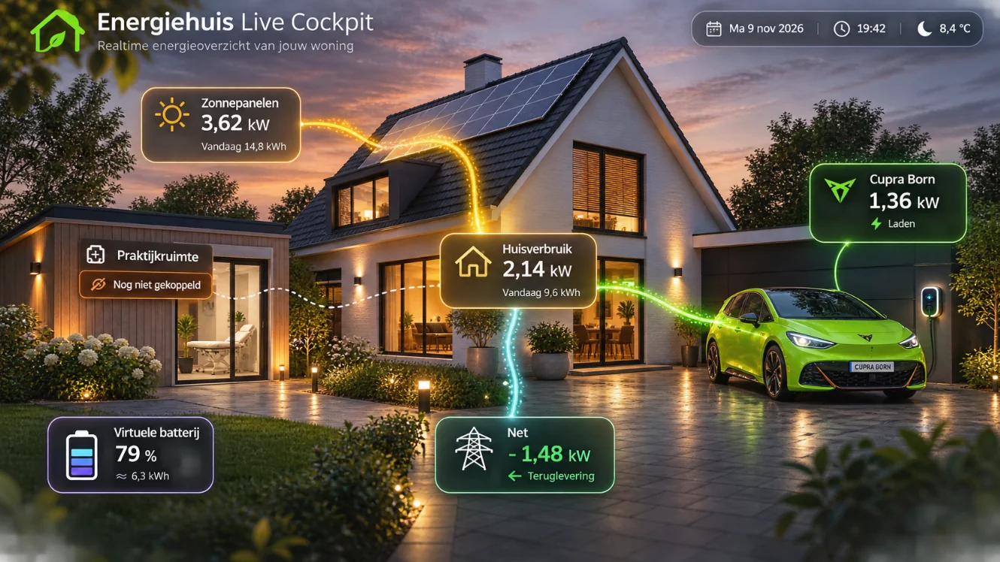

# Goedgekeurde visuele referentie — PVE-03

Deze illustratie is op 9 november 2026 door de gebruiker expliciet gekozen als de visuele richting voor **Energiehuis Live Cockpit**.



## Herkomst
- Bron: door de gebruiker gedeelde afbeelding `image(20261109-092713).png` uit de ChatGPT-ontwerpchat.
- Oorspronkelijke bron: **1330 × 748 PNG**, SHA-256: `3c81b1f253437e5308cbda64aabbe711a25162c4b9a35583fc0062a3b1f708f0`.
- GitHub-versie: **1330 × 748 WebP, kwaliteit 85**, SHA-256: `932d0e745f8e8a415f6aab4e87091366a32d5a68d7363b908f55445fcccc7ee6`. Een visueel hoogwaardige, maar verliesgevende kopie van het origineel. **Geen pixel-identieke bron**.
- Afbeelding is uitsluitend een **ONTWERPREFERENTIE**, niet een gekoppeld energie-dashboard.
- **Alle getoonde waarden, tijdstip, weersomstandigheden en energiestromen zijn fictief en dienen alleen ter illustratie.**
- Bevat al ingebakken UI en flowlijnen: **niet** als gehele achtergrond in de app gebruiken. Maak de scène-achtergrond zonder labels, cijfers of energiestromen; bouw die als onafhankelijke interactieve lagen.

## Wat overnemen
- Warm verlichte woning centraal, architecturale diepte en realistische gevel/dakstructuur.
- Zonnepanelen linksboven, geel/gouden route richting huis.
- Virtuele batterij rechtsboven, duidelijk virtueel; geen fysieke route.
- Praktijkruimte links onder, status **Nog niet gekoppeld**, geen verzonnen echte vermogensmeting.
- Knalgroene Cupra Born prominent rechts, ook zichtbaar op mobiel en tablet.
- Net midden onder huis; teruglevering huis → net, netafname net → huis.
- Atmosferische avondlucht, warm tuinlicht, reflecties, groen, weinig visuele ruis.
- Zwevende leesbare panelen die woning en auto niet afdekken.

## Hoe over te nemen in Claude's branch
De afbeelding en dit document staan op de **aparte** branch `preview/chatgpt-pve03-approved-reference`. De Claude-branch `preview/claude-premium-pve03` is **niet aangepast**.

Vanuit de eigen Claude-werkbranch kan Claude de referentie ophalen met:

```sh
git fetch origin preview/chatgpt-pve03-approved-reference
git restore --source=origin/preview/chatgpt-pve03-approved-reference -- \
  preview/pve-03/reference/approved-visual-20261109.webp \
  preview/pve-03/reference/APPROVED_VISUAL_REFERENCE.md
```

Of cherry-pick de referentiecommit zodra zijn SHA uit GitHub is gecontroleerd.

Geen merge, productiecodewijziging of release is nodig.
