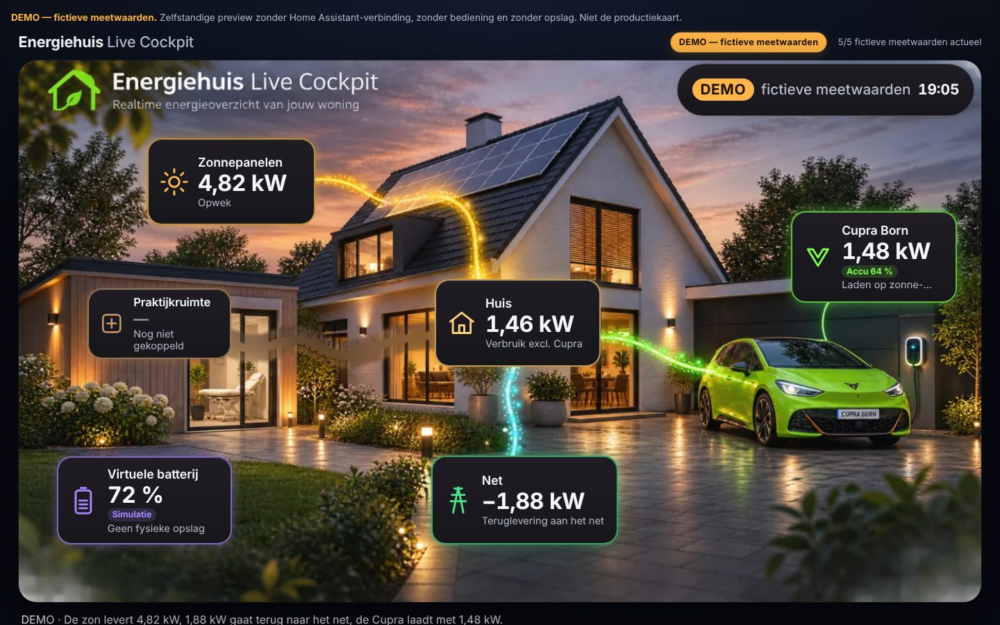

# PVE-04 — Energiehuis Live Cockpit op de goedgekeurde master

> **DEMO — fictieve meetwaarden.** Zelfstandige browserpreview zonder Home Assistant, zonder bediening en zonder opslag. Geen productiekaart, geen HACS-resource.

Branch `preview/claude-premium-pve04`. Alles staat in `preview/pve-04/`. Overdracht: [HANDOFF_TO_CHATGPT.md](HANDOFF_TO_CHATGPT.md) · Rechten: [ASSET_RIGHTS.md](ASSET_RIGHTS.md).



## Master-cockpit (standaard, sinds 9 november 2026)

De eigenaar heeft `preview/pve-03/reference/approved-visual-20261109.webp` expliciet goedgekeurd als **definitieve visuele referentie, inclusief de ingebakken kaarten en stromen**. Die afbeelding is nu ongewijzigd de achtergrond. De eerdere regel "niet als gehele achtergrond gebruiken" in `pve-03/reference/APPROVED_VISUAL_REFERENCE.md` is daarmee door de eigenaar vervangen. Het bestand wordt **niet gekopieerd**: de preview verwijst ernaar en er worden geen afgeleide beeldbestanden opgeslagen.

```
master (WebP, 1330×748, exact ongewijzigd)                              ← master-scene.js (SHA-256 gecontroleerd)
  └ bewegende lichtpunten langs de ingebakken lijn, routekleur + richting ← alleen bij een geldige, actuele, actieve route (model.js)
  └ glaskaarten exact over de ingebakken kaarten (ondoorzichtig basisvlak) ← kaartmaat + 6 px (onder + 8 px)
  └ DEMO-pil over de ingebakken datum/tijd
```

| Bestand | Rol |
|---|---|
| `master-scene.js` | **Gegenereerd** door `tools/build-master-scene.cjs` uit `cleanplate/overlay-map.json`: verwijzing naar de master (bytes, SHA-256), afdekvlakken per kaart en de geometrie van de vijf ingebakken lijnen (alleen gebruikt als pad voor de lichtpunten). `--check` faalt bij elke afwijking. |
| `master.js` | Runtime: glaskaarten, lichtpunten, detailpaneel, scenario's, drie weergaven. Dezelfde veiligheidsregels als de vorige cockpit (model.js). |

**Ingebakken lichtlijnen = decoratief (RC2-besluit).** De lijnen in de afbeelding worden niet meer bewerkt; ze zijn altijd zichtbaar en tonen **geen** actuele stroom. Dit staat in een legenda onder het beeld, in de alt-tekst en in het detailpaneel. Actuele stroom = bewegende lichtpunten (alleen bij een actieve route; bij 0 W, offline, verouderd of ongeldig staan ze stil en verdwijnen ze) plus de kaarten. **Het P1-probleem (de ingebakken lijnen bij 0 W/offline onzichtbaar maken zonder beeldverlies) is niet opgelost.** De RC1-rustlagen zijn verwijderd omdat ze zichtbare wazige banen gaven; een RC2-prototype met zonegebonden correctie haalde de kwaliteitseis niet (zie `HANDOFF_TO_CHATGPT.md`).

**Netrichting:** teruglevering = cyaan (kaartaccent, lichtpunten huis → net, "↓ naar net"), netafname = oranje (kaartaccent, lichtpunten net → huis, "↑ van net"). De ingebakken netlijn blijft cyaan; alleen de lichtpunten en de kaart wisselen van kleur. Richting, pijl en kleur verschijnen alleen bij een actieve netroute; anders staat er "Richting niet bevestigd".

**Glaskaarten:** onder elke kaart ligt een ondoorzichtig basisvlak. Het kleurverloop daarvan wordt eenmalig in de browser bemonsterd uit de rand boven en onder de kaart (~20 ms). Daarover ligt een halfdoorzichtige glaslaag met gekleurde rand, binnengloed en buitengloed, zoals in de referentie. Oude waarden kunnen niet doorschijnen; dat wordt getest met verborgen kaartinhoud. Zonder leesbare canvas (`file://`) valt het basisvlak terug op een vaste tint.

**Weergaven:**
- **`overlay`** (≥ 900 px): volledige kaarten op de master.
- **`compact`** (mobiel/tablet): dezelfde kaarten op de master, met alleen de waarde (plus netrichting of "Simulatie"); geen dubbele set eronder. Tikvlakken worden onzichtbaar vergroot tot ≥ 48 px en de DEMO-scenario's zijn standaard ingeklapt.
- **`list`** (smaller dan 21 × de tekstgrootte, of tekst > 125 %): lege glasvlakken op de master en een leesbare lijst eronder.

Zonder master of scènedata blijft alleen de lijst over.

**Bekende beperkingen**
- **P1 niet opgelost:** bij 0 W en offline blijven de ingebakken gloeiende lijnen zichtbaar (decoratief, met legenda).
- In de compacte weergave op 360–390 px zijn de waarden ~11 px.
- De netlijn in het beeld blijft cyaan, ook bij afname.
- Het kenteken "CUPRA BORN" en het merklogo blijven in beeld (geaccepteerd door de eigenaar, privégebruik).

## HA-01 — alleen-lezen LIVE-cockpit (voorbereiding, gesimuleerde Home Assistant)

**Contract en beeldroute:** [ha/HA_DATA_CONTRACT.md](ha/HA_DATA_CONTRACT.md). Geen echte HA-verbinding, geen installatie, geen servicecalls.

| Bestand | Rol |
|---|---|
| `ha/contract.js` | Datacontract: standaard-entiteiten en sleutels exact uit de productiekaart; toon-TTL (productie) en strengere route-TTL per bron (`route_ttl_s`), balansspreiding (`balance_max_skew_s`), stabiliteit, teken, configuratievalidatie |
| `ha/adapter.js` | Leest `hass.states`/`hass.connected` (frontendcontract), geeft state-objecten ongewijzigd door aan `model.js`, detecteert wijzigingen op referentie, plant hercontrole op de eerstvolgende route- of toon-TTL-grens |
| `ha/live-card.js` | `<energiehuis-live-cockpit-preview>` (shadow DOM; niet geregistreerd als dashboardkaart): LIVE-modus van `master.js`, één rAF per frame, één timer, `suspend`/`resume` bij ontkoppelen, beeld via `media_source/resolve_media` (time-out 15 s, veilige terugval, herstel na herverbinding) |
| `ha/sim.js`, `ha/index.html`, `tools/serve-ha-preview.cjs` | Uitsluitend testomgeving: 17 gesimuleerde HA-scenario's (o.a. deels vertraagd, niet synchroon) en testhaken voor mislukte/onveilige beeld-resolves en een gesimuleerde getekende `/media`-route |

```sh
node preview/pve-04/tools/serve-ha-preview.cjs        # http://127.0.0.1:8123/pve-04/ha/
node --test preview/pve-04/tests/ha-adapter.test.cjs preview/pve-04/tests/ha-freshness-sync.test.cjs
node preview/pve-04/tests/ha-live.cjs [--browser=webkit] [--screenshots]
```

LIVE is strikt gescheiden van DEMO: geen DEMO-labels, geen fictieve waarden, geen scenario's en geen schommeling. Er staat een badge "LIVE · alleen-lezen", en de pil toont OFFLINE zonder verbinding.

De eerdere **placeholder- en privélaag-cockpit** (stap 0/1A) blijft beschikbaar via `?scene=placeholder` en `?scene=private` en wordt als regressie getest. De beschrijving hieronder gaat over die variant.

## Starten

```sh
cd preview/pve-04
python3 -m http.server 8000      # open http://localhost:8000
```

Ook direct te openen als `index.html` (file://): manifest, beeldlagen en maskers laden zonder netwerk.
Start vanuit `preview/` (de master staat in `pve-03/reference/`): `cd preview && python3 -m http.server 8000` en open http://localhost:8000/pve-04/.
URL-opties: `?scenario=<id>` (o.a. `zon-export`, `nul-watt`, `offline`, `verouderd`, `praktijk-sim`), `?ticker=0`, `?instances=2`, `?scene=placeholder|private`; testhaken `?masterScene=0`, `?masterBase=missing`, `?manifest=0`.

## Architectuur

```
fotorealistische, tekstvrije beeldlaag (<picture>, WebP + JPEG, 1×/2×)     ← scene-manifest.js
  └ SVG-routelijnen + canvas-lichtdeeltjes (flows.js)                       ← model.js (routes, veiligheid)
      └ occlusiemasker (PNG, alfa = voorgrond): deeltjes/lijnen verdwijnen achter auto, struiken, paaltjes
  └ UI-kaarten, labels, waarden (app.js)  — altijd boven routes en maskers
```

| Bestand | Rol |
|---|---|
| `scene-manifest.js` | **Gegenereerd, schema v2.** Coördinatenstelsel `normalized-image`. Per compositie (desktop 16:9, mobiel 9:16): beeldlagen en maskers (type, afmetingen, bytes, SHA-256, maskerkader), budget, ankerpunten, `uiZones`, `keyObjects`, `protectedAreas`, optionele `lightLayers`; plus status en rechten. Puur data, laadt als script. |
| `manifest-validate.js` | Pure `validateManifest()`: gooit nooit, accepteert v1 en v2; de runtime bouwt de scène alleen bij een geldig manifest. |
| `ASSET_RIGHTS.md` | Rechtenregister met per asset de herkomst, licentie, bewijs en SHA-256, plus het sjabloon voor stap 1. |
| `.gitignore` | Blokkeert ruwe en betaalde bronbestanden (`.blend`, `.fbx`, `.glb`, `.exr`, `.hdr`, `.psd`, …). |
| `tools/build-manifest.cjs` | Bouwt het manifest uit de echte bestanden; `--check` faalt bij elke afwijking. |
| `tools/render-scene.cjs` + `tools/scene.html` | Generator voor de **placeholder**-laag en de occlusiemaskers. Niet de stap-1-pipeline. |
| `tools/rights.json`, `tools/render-output.json` | Bron voor de rechten en de ankerpunten van het manifest. |
| `model.js`, `flows.js`, `app.js`, `styles.css`, `index.html` | Uit PVE-03; `app.js` leest nu het manifest en `flows.js` ondersteunt maskers. |

### Terugvalgedrag

| Situatie | Gedrag |
|---|---|
| Manifest ontbreekt | Melding "Scènelaag ontbreekt — alleen interface"; geen scène of routes; kaarten en waarden werken volledig |
| Beeldlaag laadt niet | Melding "Beeldlaag kon niet laden — alleen interface"; scène en routes verborgen |
| Manifest ongeldig | Melding "Scènemanifest ongeldig — alleen interface"; geen scène of routes; interface volledig |
| Masker laadt niet | Scène en routes blijven; deeltjes worden niet gemaskeerd (alleen visueel, nooit een datawijziging) |
| Status `placeholder` | Permanente melding "Tijdelijk beeld — niet visueel goedgekeurd" |

## Placeholder-generator en manifest bijwerken

```sh
npm install --prefix /tmp/pve04-three three@0.170.0
THREE_DIR=/tmp/pve04-three/node_modules/three node preview/pve-04/tools/render-scene.cjs
node preview/pve-04/tools/build-manifest.cjs
```

Bij stap 1 vervangen de Blender-renders de bestanden. Daarna worden `tools/render-output.json` (ankerpunten), `tools/rights.json` en het `SCENE`-blok in `build-manifest.cjs` bijgewerkt en het manifest opnieuw gebouwd. De UI en de tests blijven gelijk.

## Privébeeldlaag (stap 1A: clean plate van de goedgekeurde master)

De fotorealistische basislaag wordt een **clean plate** van de goedgekeurde master: zonder kaarten, tekst, logo's, kenteken en stromen. Die laag is **privé** en komt nooit in deze publieke repository. De volledige workflow, analyse en criteria staan in [cleanplate/CLEANPLATE.md](cleanplate/CLEANPLATE.md).

```sh
python3 preview/pve-04/tools/cleanplate.py all                      # masker, draft, QA, overzicht → private/cleanplate/
node preview/pve-04/tools/build-manifest.cjs --private preview/pve-04/private/<map>
# open index.html?scene=private&privateManifest=private/<map>/scene-manifest.private.js
```

- `?scene=private` laadt een privémanifest (standaard `private/scene-manifest.private.js`; in Home Assistant `/local/energiehuis/pve04/…`). Alleen same-origin `.js`-paden onder `private/` of `/local/` worden geaccepteerd.
- Per compositie geldt: privélaag aanwezig ⇒ "Privébeeldlaag (concept) — niet visueel goedgekeurd"; geen privélaag voor die weergave ⇒ terugval op de placeholder, met melding. Een ontbrekend, ongeldig of onveilig manifest ⇒ placeholder, zonder fouten.
- `private/` staat in `.gitignore`. De tools weigeren output elders, en de validator eist `publicAllowed: false` voor privé-assets.

## Coördinaten, zones en beschermde gebieden (v2)

- **Coördinaten:** alles in fracties (0..1) van de natuurlijke beeldmaat, met de oorsprong linksboven, x naar rechts en y naar beneden. Op het scherm via `object-fit: cover`, gecentreerd (`flows.coverTransform`).
- **`uiZones`:** per kaart een gebied waarin het midden van die kaart moet liggen. Zones overlappen onderling niet.
- **`keyObjects`:** kaders van woning, garage, auto, praktijk, panelen en wandlader, geprojecteerd vanuit de 3D-scène. Objecten volledig buiten beeld staan in `outOfView`.
- **`protectedAreas`:** de herkenbare kern van auto, praktijkpui, panelen en dak/topgevel (een kader minus marges per object). **Geen kaart mag een beschermd gebied raken**; dit wordt getest op 320, 390, 768, 1330 en 1440 px.
- **`lightLayers`:** optioneel. Nu wordt alleen trigger `always` getoond; andere triggers zijn voor later en worden genegeerd. Extra velden breken niets.

## Prestaties en maskeringsmodus

Standaard is de modus `bbox`: het masker wordt per resize één keer voorgeschaald, en per frame wordt alleen het maskerkader weggesneden. De SVG-routelaag heeft een eigen compositielaag. Alternatieven voor metingen: `?maskmode=full|css` en `?svgmask=0`. Meten:

```sh
node preview/pve-04/tests/perf.cjs --write     # PVE-03 vs PVE-04-varianten, 3 runs, 1× en 4× CPU
```

Doel bij 4×: ≥ 50 fps en p95 ≤ 33 ms (45–49 fps = waarschuwing, < 45 = doel niet gehaald, < 30 = harde fout). Laatste resultaten: `screenshots/perf.json`.

## Tests

```sh
TZ=UTC node --test preview/pve-04/tests/*.test.cjs
TZ=Europe/Amsterdam node --test preview/pve-04/tests/*.test.cjs
node preview/pve-04/tests/browser.cjs --screenshots                   # Chromium
node preview/pve-04/tests/browser.cjs --browser=webkit --screenshots  # WebKit (Playwright)
node preview/pve-04/tests/perf.cjs --write
node preview/pve-04/tests/master.cjs --screenshots                    # master-cockpit, Chromium
node preview/pve-04/tests/master.cjs --browser=webkit --screenshots   # master-cockpit, WebKit
```

- **Master (31 controles, Chromium én WebKit):** 8 viewports × 2 scenario's (320–1920 px, incl. grote waarden en lange labels) met dekking ≥ ingebakken kaart + 5 px, ondoorzichtig basisvlak, tikvlakken ≥ 48 px zonder overlap, geen afkapping, geen dubbele set en een compact eerste scherm; 200 % tekst ⇒ lijst; **doorschijntoets** (kaartinhoud verborgen, witte glyfpixels = 0); netrichting kaart/kleur/pijl/tekst/lichtpunten = model voor alle 14 scenario's; master onaangetast en lichtpuntlaag leeg bij 0 W/offline; lichtpunten bewegen alleen bij actief; DEMO/simulatie/praktijk/minteken/legenda; 50 hertekeningen; terugval (geen scène, beeld-404, `file://`); toetsenbord + inklapbare scenario's; reduced motion; twee instanties + destroy; performance (Chromium: ≥ 50 fps bij 4×, hoofdthread ≤ 150 ms); screenshots.
- **HA-01 RC1:** Node `ha-adapter.test.cjs` (11) en `ha-freshness-sync.test.cjs` (17: dataversheid, asynchrone meetketen, geen fixtures in LIVE); browser `ha-live.cjs` (18 controles incl. screenshots).
- **Node (84 tests):** model en veiligheid, routes, manifest (actualiteit, hashes, afmetingen, budgetten, rechten, ruwe bestanden, ankerpunten, geen netwerk), plus manifest v2 en de validator: v1-compatibiliteit, lichtlagen, **25 negatieve gevallen**, padveiligheid, geometrie van zones en beschermde gebieden, en de responsieve omzetting; plus de clean-plate- en privacytests (overlay-map, geen getrackte privébestanden, weigering van output buiten `private/`, privémanifest, veilige URL's).
- **Browser-regressie placeholder/privélaag (26 controles, Chromium én WebKit, `?scene=placeholder`):** o.a. het laden van de privélaag via een synthetische testlaag, met mobiele terugval en terugval bij een ontbrekend of onveilig manifest; viewports, 200 % tekst, scenario's, 50 hertekeningen, stilstaande deeltjes, EV/minteken/overgangen, maskers (pixelmeting), placeholder, terugval, validatie in de browser, beschermde gebieden en zones op 5 breedtes, **visuele SVG-maskercontrole** (screenshotvergelijking), toetsenbord, reduced motion, verborgen tab, twee instanties en performance (alleen Chromium/CDP).

## Beperkingen

- Placeholder-variant: de scènelaag is een CGI-placeholder. De standaardcockpit gebruikt de goedgekeurde master.
- Getest in Chromium 153 en Playwright-WebKit 26.6 (Linux, headless). **Echte Safari op iPhone/macOS is niet getest** en blijft vereist vóór acceptatie.
- Fps-metingen zijn headless-metingen en geen meting op een echt toestel.
