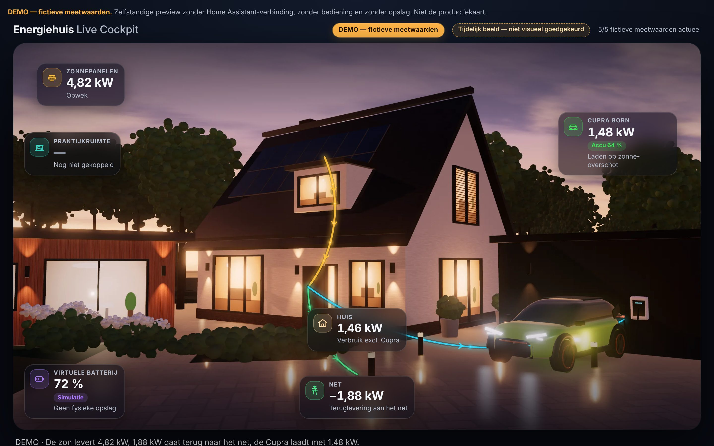

# PVE-04 — Fotorealistische Premium Live Cockpit (stap 0: beeldinfrastructuur)

> **DEMO — fictieve meetwaarden.** Zelfstandige browserpreview zonder Home Assistant, zonder bediening en zonder opslag. Geen productiekaart, geen HACS-resource.
>
> **Tijdelijk beeld — niet visueel goedgekeurd.** De huidige scènelaag is de PVE-03-CGI, uitsluitend als placeholder. Fotorealisme is een harde acceptatie-eis voor de definitieve lagen (stap 1).

Branch `preview/claude-premium-pve04`, technische basis PVE-03 `cae8edf`. Alles staat in `preview/pve-04/`. Overdracht: [HANDOFF_TO_CHATGPT.md](HANDOFF_TO_CHATGPT.md) · Rechten: [ASSET_RIGHTS.md](ASSET_RIGHTS.md) · Visuele norm: [goedgekeurde referentie (PVE-03)](../pve-03/reference/APPROVED_VISUAL_REFERENCE.md).



## Starten

```sh
cd preview/pve-04
python3 -m http.server 8000      # open http://localhost:8000
```

Ook direct te openen als `index.html` (file://): manifest, beeldlagen en maskers laden zonder netwerk.
URL-opties: `?scenario=<id>`, `?ticker=0`, `?instances=2`, en de testhaak `?manifest=0` (simuleert een ontbrekend manifest).

## Architectuur

```
fotorealistische, tekstvrije beeldlaag (<picture>, WebP + JPEG, 1×/2×)     ← scene-manifest.js
  └ SVG-routelijnen + canvas-lichtdeeltjes (flows.js)                       ← model.js (routes, veiligheid)
      └ occlusiemasker (PNG, alfa = voorgrond): deeltjes/lijnen verdwijnen achter auto, struiken, paaltjes
  └ UI-kaarten, labels, waarden (app.js)  — altijd boven routes en maskers
```

| Bestand | Rol |
|---|---|
| `scene-manifest.js` | **Gegenereerd.** Per compositie (desktop 16:9, mobiel 9:16): beeldlagen en maskers met type, afmetingen, bytes en SHA-256, budget, ankerpunten, rechten-ID; plus de status (`placeholder`/`approved`) en de rechtenregels. Puur data, laadt als script. |
| `ASSET_RIGHTS.md` | Rechtenregister met per asset de herkomst, licentie, bewijs en SHA-256, plus het sjabloon voor stap 1. |
| `.gitignore` | Blokkeert ruwe en betaalde bronbestanden (`.blend`, `.fbx`, `.glb`, `.exr`, `.hdr`, `.psd`, …). |
| `tools/build-manifest.cjs` | Bouwt het manifest uit de echte bestanden; `--check` faalt bij elke afwijking. |
| `tools/render-scene.cjs` + `tools/scene.html` | Generator voor de **placeholder**-laag en de occlusiemaskers. Niet de stap-1-pipeline. |
| `tools/rights.json`, `tools/render-output.json` | Bron voor de rechten en de ankerpunten van het manifest. |
| `model.js`, `flows.js`, `app.js`, `styles.css`, `index.html` | Uit PVE-03; `app.js` leest nu het manifest en `flows.js` ondersteunt maskers. |

### Terugvalgedrag

| Situatie | Gedrag |
|---|---|
| Manifest ontbreekt | Melding "Scènelaag ontbreekt — alleen interface"; geen scène of routes; kaarten en waarden werken volledig |
| Beeldlaag laadt niet | Melding "Beeldlaag kon niet laden — alleen interface"; scène en routes verborgen |
| Masker laadt niet | Scène en routes blijven; deeltjes worden niet gemaskeerd (alleen visueel, nooit een datawijziging) |
| Status `placeholder` | Permanente melding "Tijdelijk beeld — niet visueel goedgekeurd" |

## Placeholder-generator en manifest bijwerken

```sh
npm install --prefix /tmp/pve04-three three@0.170.0
THREE_DIR=/tmp/pve04-three/node_modules/three node preview/pve-04/tools/render-scene.cjs
node preview/pve-04/tools/build-manifest.cjs
```

Bij stap 1 vervangen de Blender-renders de bestanden. Daarna worden `tools/render-output.json` (ankerpunten), `tools/rights.json` en het `SCENE`-blok in `build-manifest.cjs` bijgewerkt en het manifest opnieuw gebouwd. De UI en de tests blijven gelijk.

## Tests

```sh
TZ=UTC node --test preview/pve-04/tests/*.test.cjs
TZ=Europe/Amsterdam node --test preview/pve-04/tests/*.test.cjs
node preview/pve-04/tests/browser.cjs --screenshots
```

- **Node (38 tests):** model en veiligheid (uit PVE-03), routes, plus het manifest: actualiteit, bytes, SHA-256, type en afmetingen, WebP+JPEG, beeldverhouding, maskers met alfa, budgetten, rechtenvelden, kruiscontrole met `ASSET_RIGHTS.md`, geen ongeregistreerde of ruwe bestanden, ankerpunten, en laden zonder netwerk.
- **Browser (21 controles):** alles uit PVE-03, plus:
  - maskers op desktop en mobiel: pixelmeting met 0 deeltjespixels onder het masker, het SVG-masker op de routelijnen, en de kaarten bovenop;
  - de placeholdermelding en de batterij linksonder;
  - het terugvalgedrag (geen manifest, beeldlaag 404, masker 404).

## Beperkingen

- De scènelaag is een **placeholder** (CGI) en geen visueel eindbeeld.
- Alleen getest in Chromium 153 headless; Safari/WebKit en echte apparaten zijn niet getest.
- Het maskeren per frame kost rekentijd: onder 4× CPU-throttling ~39 fps (zonder masker ~58).
